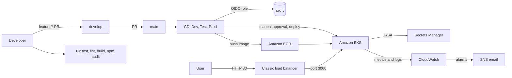

# Architecture

**Author:** Kaushik Shettigar
**Region:** `ap-south-1` (Mumbai)

## 1. Overview

A Node.js (Express) application is built, tested and scanned by GitHub Actions, packaged as a Docker image in Amazon ECR and deployed to Amazon EKS. Pipelines authenticate to AWS with OpenID Connect (no stored keys), pods read their configuration secret from AWS Secrets Manager through IAM Roles for Service Accounts (IRSA), and CloudWatch collects metrics, logs and alerts.

## 2. Components

| Component | Role |
|---|---|
| GitHub | Source control with rulesets on `main` and `develop` that require pull requests and block force pushes |
| GitHub Actions | CI (`ci.yml`) and the multi-stage CD pipeline (`cd.yml`) |
| IAM role with OIDC | Short-lived AWS credentials for the workflows |
| Amazon ECR | Private image repository `devops-ai-masters-capstone`, with image scanning and a lifecycle policy |
| Amazon EKS | Cluster `devops-ai-capstone` (Kubernetes 1.34), managed node group `capstone-ng` with two `t3.small` nodes |
| Kubernetes workload | Deployment with two replicas, a LoadBalancer Service and readiness and liveness probes on `/health` |
| AWS Secrets Manager and IRSA | The pods read one application secret through the service account `devops-ai-capstone` |
| CloudWatch | Container Insights metrics, alarms, application and node logs, EKS control-plane logs |
| SNS | Email notifications for alarms |
| Terraform | CloudWatch logging configuration for the existing cluster |
| Helm | Chart in `helm/devops-ai-capstone` for parameterized deployments |

EKS add-ons in use: CoreDNS, kube-proxy, metrics-server, VPC CNI and the Amazon CloudWatch Observability add-on.

## 3. CI/CD flow

1. A developer pushes a `feature/*` branch and opens a pull request into `develop`.
2. **CI** runs on pushes and pull requests: dependency install, tests, lint, build, build-output verification and a dependency audit that fails on critical vulnerabilities.
3. After review, the change is merged into `develop`, then promoted to `main` with another pull request.
4. A push to `main` starts **CD**:
   - **Dev - Build and Test:** builds and tests the application.
   - **Test - Validate Image and Application:** validates the image and the application.
   - **Prod - Deploy to Amazon EKS:** requires manual approval through the GitHub `production` environment. It then builds the production image, pushes a commit-specific tag and `latest` to ECR, configures Kubernetes access, deploys to EKS and verifies the rollout.

In this implementation all three stages belong to one pipeline and the production stage deploys to the single EKS cluster. Separate clusters or namespaces per stage would be a natural extension.

## 4. Runtime request flow

1. A client calls the classic load balancer created by the `LoadBalancer` Service on port 80.
2. The load balancer forwards to the pods on container port 3000.
3. Kubernetes uses `/health` for readiness and liveness probes. `/secret-status` reports whether the Secrets Manager secret can be read, without returning its value.

## 5. Network layout

- The VPC (`192.168.0.0/16`) was created by eksctl across several availability zones.
- The worker nodes run in subnets whose route table sends `0.0.0.0/0` to the Internet Gateway, and the nodes have public IP addresses.
- A separate route table sent a private subnet's traffic through a NAT gateway. Nothing ran behind it and it carried no traffic, so it was removed (see [cost-optimization.md](cost-optimization.md)).
- The node security group allows all outbound traffic, and the network ACL allows all IPv4 traffic. IPv6 is not enabled in the VPC CNI.

## 6. Observability

- **Metrics and alarms:** Container Insights collects node and pod metrics. The alarms `capstone-node-cpu-high` (above 70%) and `capstone-node-memory-high` (above 75%) notify an SNS email topic ([monitoring.md](monitoring.md)).
- **Logs:** Fluent Bit ships application, node and performance logs to CloudWatch Logs with 7-day retention. Logs Insights queries find recent errors ([logging.md](logging.md)).
- **Control plane:** API, audit, authenticator, controller manager and scheduler logs go to `/aws/eks/devops-ai-capstone/cluster`.

## 7. Design decisions and trade-offs

| Decision | Reason | Trade-off |
|---|---|---|
| OIDC instead of access keys | No long-lived secrets to leak or rotate | Requires trust policy setup |
| IRSA for Secrets Manager | The pods get only the one secret they need | More setup than a node-wide role |
| Reuse existing eksctl cluster and reference it from Terraform | Avoids rebuilding the cluster, and Terraform changes stay small | Terraform does not own the whole platform |
| Helm as a separate release | Demonstrates packaging without risking the live deployment | The pipeline still deploys with `kubectl apply` |
| Nodes in public subnets | No NAT gateway cost | Nodes have public IPs and rely on security groups |
| Scale nodes to zero when idle | Low compute cost | The control plane still bills hourly |
